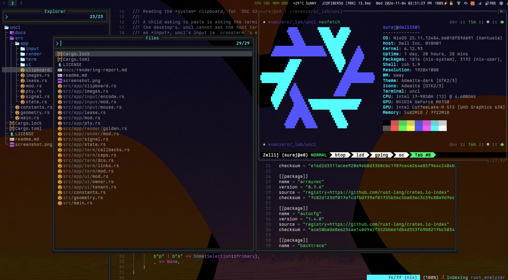

```
░█░█░█▀█░█▀▀░█░░
░█░█░█░█░█░░░█░░
░▀▀▀░▀░▀░▀▀▀░▀▀▀
v0.1.15
```

 [](https://github.com/even-zero/uncl/actions/workflows/release.yml)

## inspiration

terminal multiplexers are overkill. tmux involves a learning curve most could do without and zellij is ... an acquired taste lets just say. what if there was something for the terminal monotaskers among us, something simpler than existing solutions that makes that extra terminal tab unncessary, something that minimises context-switch cognitive load and looks cool while doing it.

## introduction

uncl is a terminal monoplexer - a single, toggleable, resizeable, and draggable floating term window as an accomplice to your worst terminal misdeeds, written in rust.



## features

- toggle a floating terminal with a single `[Home]` key
- `exit` in the float closes it; the next `[Home]` opens a fresh shell (nothing
  is restarted behind your back)
- no nesting: running `uncl` again in the background shell toggles the float,
  and running it inside the float is refused with a message
- pin the float in place with the `[ ]`: a pinned float stays on screen while you
  type in the shell behind it
- floating term is draggable and resizeable with mouse
- floating term is draggable and resizeable with keyboard
- supports most shells, tested on zsh, bash
- supports most terminal emulators, tested on Wezterm, Xfce Terminal, Ghostty, Alacritty etc.
- images render inside the float
- clickable links inside the float
- scrollback in both panes
- mouse support in both panes, text selection with `Ctrl+C`/`Ctrl+V`
- copy and paste (`OSC 52`)
- children get your terminal's `TERM` (alacritty, foot, wezterm, xterm...), and
  `xterm-256color` where uncl cannot carry what that `TERM` implies: `screen`/
  `tmux` dialects, and kitty's keyboard protocol. `uncl --doctor` prints both

## installing

prebuilt archives are attached to the releases: `uncl-linux-x86_64.tar.gz`,
`uncl-windows-x86_64.zip`, `uncl-macos-aarch64.tar.gz` and
`uncl-macos-x86_64.tar.gz`. each holds the binary, `readme.md` and `LICENSE`.
unpack it and put `uncl` somewhere on your `PATH`.

- linux: built on ubuntu 22.04, so it wants glibc 2.35 or newer.
- macos: neither signed nor notarised - the first run needs
  `xattr -d com.apple.quarantine uncl`, or right-click -> open in finder.
- windows: windows 10 1809 or newer, for a console that speaks ansi.

or install with cargo:

```sh
cargo install uncl
```

this pulls the crate from crates.io, so you need a rust toolchain (edition 2024,
so rust 1.85 or newer).

or build it from source, with a rust toolchain:

```sh
git clone https://github.com/even-zero/uncl && cd uncl
cargo install --path .
```

## auto load with shell

to auto-load uncl with your shell, add the following snippet to your `.{shell}rc`.
the guard matters: without it every shell uncl spawns would launch it again (and
now, with nesting refused, simply toggle the float instead of starting):

```
if [[ -z "$UNCL_STARTED" ]]; then
    export UNCL_STARTED=1
    /home/suraj/.cargo/bin/uncl
fi
```
